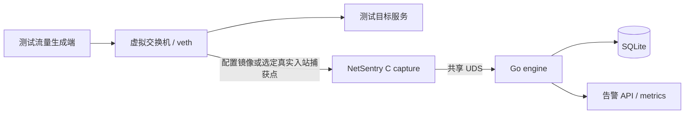

# NetSentry 项目状态与测试环境（2026-10-17）

本评估基于 `28c23b54abde8194ed899734518ba03c4079cafe` 的代码、验证记录、
GitHub Release 与路线图。当前结论：核心检测闭环可运行，适合离线分析、
实验室验证与受控小规模试用；生产容量和生产 SLO 尚未验收。
这是一份日期快照，不能用路线图完成项数量推算产品完成百分比。

**同日用户调整后的当前目标：** 采用 [local-v1 单 VM 实验版验收](acceptance-local-v1.md)。
旧 staging/prod 大规模目标延期，16 GiB/SR-IOV 不再阻塞当前推进。
新实时目标为 100 条规则、100/500 pps、10 分钟两轮、零预期告警缺失/额外事件、
分段包丢失 <=1%、主机时间戳至 WAL 返回 p99 上界 <=500ms，加 30 分钟稳定性。
新规则不等于通过。2026-10-18 更新：R90-194 增加 [schema 2 报告与证据处理](slo-local-v1.md)，
R90-195..197 仍需建立夹具与实测；本页原日期评估及其历史 CI 数值保留。


## 已验证的进度

- GitHub 最新发布版为 v0.1.1，发布时间为 2026-10-01。
  README 原先的 v0.1.0 当前状态和 Go 1.26.8 工具链描述已校正。
- 当前 main 修复了供应链漏洞门禁及三类旧测试夹具错误，Go 固定为 1.26.9。
- 完整本地 `make ci-check` 通过：供应链/漏洞扫描、全包 Go race、覆盖率、
  C 测试与 ASan fuzz、Python 证据/知识测试、E2E、打包及 Docker 健康检查。
- Go 总语句覆盖率 82.3%；当前 E2E 合成样本为 6 个包、5 条告警、8 条规则。
  这些结果证明相应功能检查通过，不代表检测准确率或生产吞吐。
- [同一提交的 GitHub CI](https://github.com/decline-llc/netsentry/actions/runs/39013061545)
  已完成并成功。详情见 [CI 修复证据](evidence/ci-repair-20261017.md)。

## 现在能完成的任务

| 能力 | 可完成的工作 | 实际边界 |
| --- | --- | --- |
| 离线流量分析 | 读取 libpcap 可识别、Ethernet 链路类型的抓包，解析 IPv4/TCP/UDP | 主测试路径；pcapng 也必须满足 libpcap 与 Ethernet 链路类型约束 |
| 实时检测 | 从明确指定的 Ethernet 接口抓包，向 Go 引擎送包并生成告警 | live capture 仍属实验能力，不能由离线成功推定生产稳定性 |
| 规则匹配 | payload 特征、IP 黑名单、端口黑名单；规则管理与热更新 | 基于规则与单包内容；当前自带 8 条示例规则，不是完整威胁库 |
| 安全告警 | 对含已配置 SQLi、XSS、路径穿越、命令注入、Log4Shell 等特征的明文载荷告警 | 特征命中表示可疑指标，不证明攻击成功 |
| 告警治理 | 抑制、敏感信息脱敏、时间窗聚合、保留清理 | 是否命中取决于规则与可见载荷 |
| 存储与查询 | SQLite、恢复日志、可选每日分片；API 查询和规则/抑制管理 | 不是分布式存储或完整 SIEM 平台 |
| 运维与测试 | 健康、Prometheus 指标、Docker/归档交付、合成数据与压力测试工具 | 有 API/命令行；没有完整可视化管理控制台 |
| SLO 工具链 | 采集/关联、报告、证据重建与比较代码及执行手册 | 端到端测量、时钟/持久化边界和容量结论尚未完成合格验收 |

暂不具备端到端 IPv6 检测、TLS 解密、IP/TCP 重组、应用层规范化及自动阻断。
跨 TCP 包分段、加密或编码载荷不能按完整明文会话处理。
它当前是被动检测引擎，不应作为成熟 IPS 或高速生产 IDS 的能力替代品。

## 测试需要搭载在哪里

### 1. 功能与回归：现有 Ubuntu VM 即可

无需先安装网络模拟器。先在独立测试目录/checkout 中运行已有入口：

```bash
make test-e2e                 # 确定性 pcap -> API 检测闭环
make test-stress              # 合成重复 pcap 压力；不是 live 到包延迟验收
make ci-check                # 固定工具预装后，完整供应链与 Docker RC 门禁
```

项目使用 Ubuntu 24.04 Docker 基础镜像；
[Docker 官方支持 Ubuntu 24.04](https://docs.docker.com/engine/install/ubuntu/)。
现有 VM 可见 16 个逻辑 CPU、约 7.7 GiB RAM，已经完成本次功能/CI 检查。
可见核数不等于独占性能保证。

Docker 镜像包含 capture 与 engine 两个程序，默认入口只启动 engine。
实时链路还需显式启动 capture、让两个进程可访问同一 UDS，并让测试流量实际
经过被监听接口；仅启动容器并看到健康接口不等于完成实时检测验证。

### 2. 自动化网络拓扑：优先考虑 Mininet

[Mininet 官方说明](https://mininet.org/overview/)支持虚拟主机、交换机和链路，
节点运行真实 Linux 程序，通过 network namespace/veth 构造网络。
据此，建议用它搭建可重复的发包端、目标服务和 NetSentry 检测接口。
这是环境建议，本次没有安装 Mininet 或执行该拓扑。



普通交换端口不会自动向检测节点转发全部单播。明确配置镜像/TAP，或把捕获点
设在流量真正进入的接口；先用 tcpdump 核对方向、Ethernet 链路类型和包数。
正式原生 SLO 测量入口目前限定未打 VLAN 标签的 Ethernet/IPv4/非分片 UDP，
不能将这个入口的结果外推为全部 TCP/VLAN/生产工作负载的验收。

### 3. 图形化多设备实验：GNS3 可选

需要拖拽拓扑、加入路由器/防火墙或 Linux 节点时，可使用 GNS3。
[GNS3 官方支持 QEMU/KVM VM 与 Docker 节点](https://docs.gns3.com/docs/getting-started/setup-wizard-local-server)，
[Docker 节点说明](https://docs.gns3.com/docs/emulators/docker-support-in-gns3)
解释了将容器作为轻量 Linux 实验节点的用法。
NetSentry 需在 Linux VM/容器内执行，网络接口、流量镜像和共享 UDS 仍需配置。
目前仓库没有已验证的 GNS3 appliance 或完整拓扑工程；导入与适配需单独验证。

## 延期的生产级目标（历史范围）

[R90-75 正式契约](performance-slo.md)的 staging、production 两种配置均没有
合格验收结果，现已延期且不作为本地实验版的前置门槛。下表数字是历史目标，不是实测容量：

| 项目 | Staging 目标配置 | Production 目标配置 |
| --- | --- | --- |
| SUT CPU / RAM | 2 vCPU / 4 GiB | 8 vCPU / 16 GiB |
| 磁盘 / NIC | 20 GB SSD / 1 Gbps 虚拟网卡 | 100 GB 专用 SSD / 10 Gbps SR-IOV VF |
| 规则数 | 2,000 | 20,000 |
| 持续 / 突发带宽目标 | 100 / 250 Mbps | 3 / 7 Gbps |
| 到包至持久化延迟目标 | p99 <= 180 ms | p99 <= 180 ms |

现有 VM 的约 7.7 GiB RAM 低于历史 production 配置，但符合本次围绕现有资源
制定的本地实验目标；实际 CPU/内存/磁盘与生成器余量仍需记录。无需先增加硬件
或搭建大型模拟器。后续按唯一[滚动路线图](plans/rolling-90-day-roadmap.md)
local-v1 报告支持已加入；接着建立 namespace/veth 夹具、执行两轮小流量实时验证
及稳定性测试。旧 [SLO runbook](slo-runbook.md)保留，不能直接判定新 profile。

交付规则见 [AGENTS.md](../AGENTS.md)：先完整验证通过，再整批上传，
并核验精确远端提交的 CI 结果。验收规则、前一轮本地状态/交付约定和规划合为同一个完整改动，
通过完整本地检查后一次上传；上传后的事实只记本地，避免额外 closure。
